 
<!-- ═══════════════════════════════════════════════════════ -->
<!--                 JAMSHID'S GITHUB PROFILE                -->
<!--                  DARK NEON EDITION                       -->
<!-- ═══════════════════════════════════════════════════════ -->

<p align="center">
  <a href="https://github.com/jamsshid">
    
  </a>
</p>

<p align="center">
  
</p>

<p align="center">
  <a href="https://github.com/jamsshid">
    
  </a>
  <a href="https://linkedin.com/in/jamsshid">
    
  </a>
  <a href="https://jamsshid.github.io/portfolio">
    
  </a>
</p>

---

<h2 align="center">⌁ &nbsp; ABOUT ME &nbsp; ⌁</h2>

```python
class Jamshid:
    def __init__(self):
        self.role = "Python Backend Developer"
        self.focus = ["Backend Engineering", "AI Engineering"]
        self.languages = ["Python", "SQL"]
        self.frameworks = ["FastAPI", "Django"]
        self.database = ["PostgreSQL"]
        self.tools = ["Docker", "Git", "Linux"]

    def currently_building(self):
        return "Scalable backends & AI-powered applications"

    def philosophy(self):
        return "Build. Break. Learn. Improve."
```

<h2 align="center">⚡ &nbsp; TECH ARSENAL &nbsp; ⚡</h2>

<p align="center">
  
</p>

<p align="center">
  
  
  
  
</p>

---

<h2 align="center">🚀 &nbsp; FEATURED PROJECTS &nbsp; 🚀</h2>

<p align="center">
  <sub>Some things I've been building lately.</sub>
</p>

<p align="center">
  <a href="https://github.com/jamsshid/ecommerce_api">
    
  </a>
</p>

<p align="center">
  <a href="https://github.com/jamsshid/finance-tracker">
    
  </a>
</p>

<p align="center">
  <a href="https://github.com/jamsshid/fids_monro_bot">
    
  </a>
</p>

<p align="center">
  <a href="https://github.com/jamsshid?tab=repositories">
    
  </a>
</p>

---

<h2 align="center">📊 &nbsp; CONTRIBUTION UNIVERSE &nbsp; 📊</h2>

<p align="center">
  <a href="https://github.com/jamsshid?tab=overview#contributions">
    
  </a>
</p>

<p align="center">
  
  
</p>

---

<h2 align="center">🌌 &nbsp; THE JOURNEY CONTINUES &nbsp; 🌌</h2>

<p align="center">
  <i>Writing code is just the beginning.<br>
  Building things that matter is the goal.</i>
</p>

<p align="center">
  <a href="https://github.com/jamsshid">
    
  </a>
</p>

<p align="center">
  
</p>

<p align="center">
  <sub>Designed & built by <a href="https://github.com/jamsshid">Jamshid Omonkeldiev</a> · 2026</sub>
</p>
