<!-- SVG cards are generated by generate_cards.py. -->
<p align="center">
  
</p>

<p align="center">
  <a href="https://github.com/jamsshid"></a>
  <a href="https://linkedin.com/in/jamsshid"></a>
  <a href="https://jamsshid.github.io/portfolio"></a>
</p>

<p align="center">
  
</p>

<p align="center"></p>
<p align="center"></p>
<p align="center"></p>

<p align="center">
  
</p>

<p align="center"><sub>Python · SVG · GitHub Actions · Plus Jakarta Sans · JetBrains Mono</sub></p>

## Regenerate locally

```bash
python -m pip install -r requirements.txt
python generate_cards.py
STATIC=1 python generate_cards.py  # render the final frame for screenshots
```

The scheduled GitHub Action refreshes `data/contributions.json` daily, renders the SVG cards and commits changed output. Run it manually from **Actions → Refresh animated profile cards → Run workflow**.
